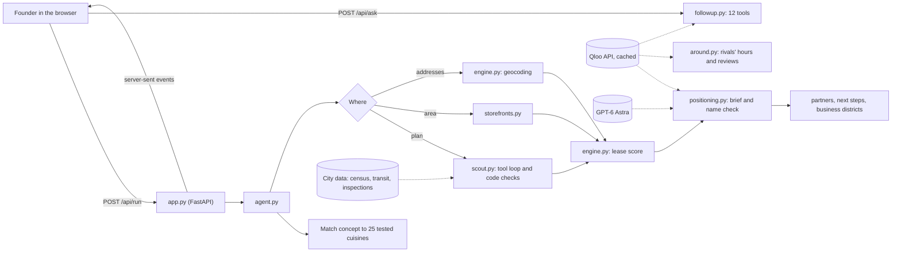
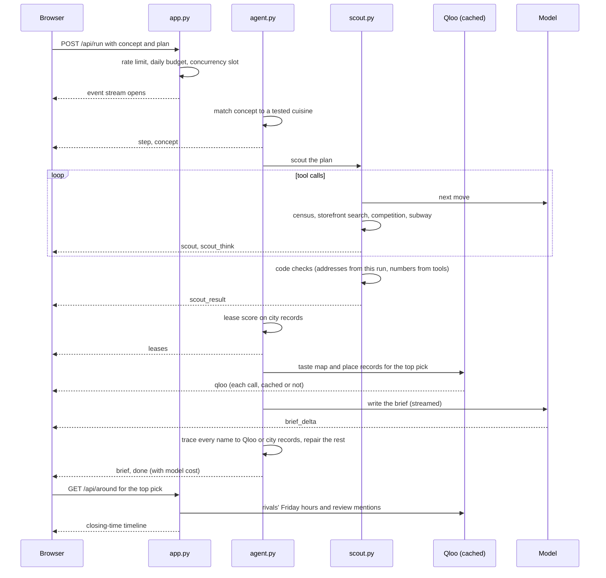

# Whitespace

**A site-selection agent for independent restaurant founders in New York City, grounded in Qloo's record of real
places.** Describe your concept and your customers. Whitespace scouts vacant storefronts, ranks them on city records,
then sizes up every rival around the top pick with Qloo: when each one closes on Friday, what its reviewers rave
about, and where its fans also go. It writes a positioning brief and answers follow-up questions with the same tools.

**Live demo:** <https://whitespace-nyc.vercel.app> · **For language models:** <https://whitespace-nyc.vercel.app/llms.txt>
· Built for the Qloo Agentic Hackathon 2026 · MIT licence

---

## Contents

1. [Why Qloo](#why-qloo)
2. [What the agent does](#what-the-agent-does)
3. [Quick start](#quick-start)
4. [Configuration](#configuration)
5. [How it works](#how-it-works)
6. [The web page](#the-web-page)
7. [HTTP API](#http-api)
8. [Saved runs and Qloo data](#saved-runs-and-qloo-data)
9. [Project layout](#project-layout)
10. [What we tested](#what-we-tested)
11. [Agent reliability](#agent-reliability)
12. [Deploying to Vercel](#deploying-to-vercel) and [Render](#deploying-to-render)
13. [Security](#security)
14. [Data sources](#data-sources)
15. [Limits](#limits)
16. [Troubleshooting](#troubleshooting)
17. [Licence](#licence)

---

## Why Qloo

A language model can reason about a neighbourhood. It cannot know when the restaurant down the block closes tonight,
what its regulars order, or which other places its fans love. Qloo can, and we measured that before building on it.
Every number below comes from a test whose rules were committed before its result existed.

| What the agent needs to know | Without Qloo | With Qloo | Test |
|---|---|---|---|
| When a real NYC restaurant closes on Friday (30 places, checked against Google Maps) | GPT-6 Astra: **0 of 30** (declined every time). Gemini 3.8 Flash: **3 of 30**, with 6 confident wrong times | **29 of 30** for both models | 20 |
| Are Qloo's closing times right? (checked by a person on Google Maps) | | **29 of 30** within 30 minutes | 12 |
| Which small artists a real listener plays (40 Last.fm listeners) | Ranking by popularity: AUC **0.516** | Qloo's taste graph: AUC **0.841** | 27 |
| A festival timetable that keeps shared fans apart (10 bills, real listening data) | Built on popularity: **0.043** of the possible gain | Built on Qloo's fan overlap: **0.663** | 28 |
| Which act really opened for a headliner | Fame: AUC **0.473**, genre: **0.714** | Qloo: AUC **0.875** | 15 |

So Qloo sits where a model is blind: every fact about a specific real place. In the product:

| Job | Source |
|---|---|
| **When rivals close, what their reviewers mention** | Qloo place records, for every competitor Qloo holds, shown on a Friday closing-time timeline |
| **Hours of any place the founder asks about** | Qloo, through the agent's `place_hours` and `competitor_hours` tools; the agent never states hours from memory |
| **Where else a restaurant's fans go, and the music and brands they follow** | Qloo entity affinity (scene explorer) |
| **The brief's local evidence** | Qloo, against a 10-area NYC baseline so only what is distinctive about the area is used |
| **Where to open** | NYC Health Department inspection records and the NYC Storefront Registry (lease score, Test 4) |
| **Who lives and works nearby** | Census and LODES jobs data |

All 28 tests, including the ones where Qloo did not help, are listed under [What we tested](#what-we-tested), and the
reasoning behind every decision is in `PROJECT_LOG.md`.

---

## What the agent does

1. **Matches the concept** to one of 25 cuisines the lease score was tested on. Keywords match in code, anything else
   by the model. A cuisine we did not test stops with a plain message.
2. **Finds candidate storefronts** in one of three ways:
   - **Describe your plan** (the main path, called *scout*): the founder says who the customers are and where they
     would consider. A tool-calling loop picks neighbourhoods from census data, searches vacant storefronts in
     several, checks competition, cuisine fit and foot traffic, and submits a shortlist. Code checks the shortlist:
     every address must come from a search in this run, every number must appear in a tool result, and a weak-fit
     pick is sent back once.
   - **Search an area**: vacant storefronts in a named neighbourhood (nicknames such as LIC or Bed-Stuy work).
   - **My addresses**: two to five addresses the founder already has.
3. **Ranks the storefronts** on city records (the Test 4 lease score: restaurants in the block plus same-cuisine supply
   in and around it).
4. **Writes a positioning brief** for the top pick from Qloo's evidence for the area, streamed to the page, then checks
   it in code. Every named business is traced to Qloo, to NYC inspection records near the address, to a business
   improvement district, or marked unverified. Lines naming a business no source backs up are rewritten or removed.
5. **Sizes up the competition with Qloo** as soon as the run finishes: the nearest competitors from city records, each
   with Qloo's Friday closing time and what its reviewers mention, on a closing-time timeline; places Qloo tags with
   the cuisine that the city files elsewhere; and the neighbours fans of the cuisine rate highest.
6. **Lists local partners and next steps** from city data, with a source link on each.
7. **Answers follow-up questions** with twelve tools, including two Qloo tools for hours (`competitor_hours`,
   `place_hours`). Numbers in an answer that appear in no tool result are flagged.

Two ways to see the Qloo difference for yourself, on the page:

- **See all 30 answers:** under "Why Qloo", every recorded answer behind Test 20, place by place: Google Maps' closing
  time, what each model said alone and with Qloo, and whether it was right.
- **Ask the model (live duel):** beside each rival with Qloo hours, one click asks GPT-6 Astra when it closes on
  Friday twice, side by side: alone, and with Qloo's record. The same question as Test 20, rerun live.

The scene explorer works on its own: name up to three places your customers love and see the places Qloo says their
fans also go, and the music and brands that crowd follows. No model is involved.

Coverage: Brooklyn, Queens, Manhattan and the Bronx. Staten Island is not covered.

---

## Quick start

Requirements: **Python 3.12 or newer** (the Render deploy uses 3.13), about 50 MB of disk for city data, and internet
access for the first build.

```bash
git clone <this repository> whitespace
cd whitespace

python3 -m venv .venv
source .venv/bin/activate            # Windows: .venv\Scripts\activate
pip install -r requirements.txt

cp .env.example .env                 # then fill in the keys you have (see Configuration)
python build_data.py                 # downloads the city data into data/ (once; needs CENSUS_API_KEY and QLOO_API_KEY)
uvicorn app:app --port 8000
```

Open <http://localhost:8000>.

**No keys?** The page still works. Saved runs replay from `fixtures/replays` with no API calls, the evidence panel
loads, and the page says plainly that live runs are off. The header stats need `data/`, which `build_data.py`
downloads.

---

## Configuration

Settings come from environment variables. For local work, put them in `.env` (git-ignored); `.env.example` lists every
one. Variables set on the host take priority over `.env`.

### Keys

| Variable | Needed for | Notes |
|---|---|---|
| `QLOO_API_KEY` | Live runs, the two Qloo lookups, the build step | Qloo Insights API (hackathon key, 10,000 calls a month). |
| `LLM_PROVIDER` | Live runs | `comet` (CometAPI, pay as you go) or `kie` (prepaid credits). Code default: `kie`. |
| `COMET_API_KEY` | Live runs when `LLM_PROVIDER=comet` | |
| `KIE_API_KEY` | Live runs when `LLM_PROVIDER=kie` | |
| `CENSUS_API_KEY` | `build_data.py` | Neighbourhood profiles from the US Census API. |
| `AZURE_OPENAI_ENDPOINT`, `AZURE_OPENAI_API_KEY`, `AZURE_OPENAI_DEPLOYMENT` | Optional | Outage fallback (Azure OpenAI v1 Responses API). Used only when the primary call fails; every fallback is labelled in the trace. |
| `TICKETMASTER_API_KEY`, `GEMINI_API_KEY` | Research scripts only | Not needed to run the app. |

A live run needs `QLOO_API_KEY` **and** the key for the chosen provider. `/health` reports `live: true` or `false`,
never a key.

### Limits and behaviour

| Variable | Default | What it does |
|---|---|---|
| `LLM_MODEL` | `gpt-6-astra` | Model name sent to the provider. |
| `LLM_HEDGE_AFTER` | `45` | Seconds before a slow model call is hedged with a second request. |
| `DAILY_CREDITS` | `300` in code, `600` in the examples | Daily model budget across all visitors. On CometAPI one unit is about $0.0142, so 600 is about $8.50 a day. |
| `RUNS_PER_HOUR` | `4` | Live runs per visitor per hour. |
| `ASKS_PER_HOUR` | `15` | Follow-up questions per visitor per hour. |
| `LOOKUPS_PER_HOUR` | `30` | Qloo lookups (no model call) per visitor per hour. |
| `DUELS_PER_HOUR` | `10` | Live "ask the model" duels per visitor per hour. |
| `MAX_CONCURRENT` | `3` | Live runs at once on the server. |
| `QLOO_RESERVE` | `300` | Qloo calls kept in reserve each month. Below this, uncached Qloo calls stop and the page says so. |
| `QLOO_CACHE_DIR` | `./cache` | Where Qloo responses are cached. Private server storage only. |
| `GOLDEN_DIR` | `./golden` | Where full saved runs live. Private server storage only. |
| `REPO_URL` | empty | Public repository; source files in the evidence panel link to it. |

---

## How it works



- **One run, streamed.** `POST /api/run` starts `agent.run` in a worker thread. Each step, each scout tool call, each
  Qloo call and each piece of the brief is sent to the page as a server-sent event, so the trace fills in as it happens.
- **The lease score** (`engine.py`, fitted by `fit_lease_model.py` and `fit_lease_model_4b.py` into
  `lease_model.json`) is a per-cuisine logistic regression on two features of a city block: `log(1 + restaurants in the
  block)` and `log(1 + same-cuisine restaurants in the block and its 8 neighbours)`. It was the winner of Test 4 and
  extended in Test 4b.
- **Code checks the model.** The scout's shortlist is checked in code (addresses from this run's searches only,
  numbers from tool results only). The brief's business names are traced to a source or marked, and untraceable lines
  are repaired or dropped. Follow-up answers have their numbers checked against tool output.
- **Qloo is cached and rationed.** `qloo.py` caches every response on disk and tracks the monthly quota from Qloo's
  rate-limit headers, stopping uncached calls when the reserve is reached.
- **The model client** (`llm.py`) speaks the OpenAI Responses format to CometAPI or Kie, hedges slow requests, detects
  "busy" and "out of budget" errors, and can fall back to Azure OpenAI.

### System layers

```
┌──────────────────────────────────────────────────────────────────────────────────────┐
│ Browser: static/index.html + style.css + app.js (no build step), Leaflet map          │
│   scout form · saved runs · results · map + live trace · scene explorer · audit        │
└───────────────▲───────────────────────────────┬──────────────────────────────────────┘
                │ server-sent events             │ JSON requests
┌───────────────┴───────────────────────────────▼──────────────────────────────────────┐
│ app.py (FastAPI): routes, Pydantic validation, per-visitor rate limits, daily model    │
│ budget, concurrency slots, replay of saved runs, /llms.txt                            │
├──────────────────────────────────────────────────────────────────────────────────────┤
│ Agent layer                                                                           │
│   agent.py (one run) · scout.py (tool loop + shortlist checks) · followup.py (tools)  │
│   positioning.py (brief, name trace, repair) · around.py / scene.py (Qloo lookups)    │
├──────────────────────────────────────────────────────────────────────────────────────┤
│ Scoring and city data                                                                 │
│   engine.py (lease score, geocoding, 25 cuisines) · nyc.py · storefronts.py           │
│   census.py · transit.py · bids.py · partners.py · next_steps.py · lease_model.json   │
├──────────────────────────────────────────────────────────────────────────────────────┤
│ Clients                                                                               │
│   qloo.py: Qloo Insights API, disk cache, monthly quota guard                         │
│   llm.py: CometAPI / Kie (GPT-6 Astra), hedging, budget detection, Azure fallback     │
├──────────────────────────────────────────────────────────────────────────────────────┤
│ Storage                                                                               │
│   data/ public city data (build_data.py) · cache/ Qloo responses (private)            │
│   golden/ full saved runs (private) · fixtures/replays/ redacted copies (public)       │
└──────────────────────────────────────────────────────────────────────────────────────┘
```

### Lifecycle of a live run



### Events on the stream

| Event | Meaning |
|---|---|
| `step` | A pipeline step started, finished or failed, with timing and detail. |
| `scout`, `scout_think`, `scout_turn`, `scout_hedge` | A scout tool call, the model thinking, which model answered a turn, a hedged request. |
| `scout_result` | The scout's shortlist and summary, after the code checks. |
| `concept` | The cuisine the concept was matched to. |
| `leases` | The ranked storefronts with every measured fact. |
| `taste` | Qloo taste scores for the comparison toggle. |
| `qloo` | One Qloo call: path, parameters, status, whether it came from cache. |
| `evidence` | The Qloo evidence given to the model for the brief. |
| `brief_delta`, `brief` | The brief as it is written, then the checked brief with its name trace. |
| `saved_followups` | Recorded follow-up answers (replays only). |
| `error`, `done` | A plain error message; the end of the run and its model cost. |

Follow-ups stream `tool` and `answer` events; `answer` carries `unchecked_numbers`.

### Where Qloo plugs in

| Place in the product | Qloo endpoint use | Shown as |
|---|---|---|
| Brief evidence (`positioning.py`) | Insights for places and tags near the lease, against a 10-area NYC baseline for distinctiveness | Highlighted names in the brief, and the "Qloo evidence given to the model" list |
| What is around the top pick (`around.py`) | Place records for city-record competitors: Friday closing time, review keywords; places tagged with the cuisine; neighbours fans of the cuisine rate highest | Runs automatically when a run finishes: a Friday closing-time timeline and red Qloo details beside each competitor |
| Scene explorer (`scene.py`) | Entity search, then places, artists and brands with affinity to 1 to 3 named places | "Where else do their fans go", labelled not validated |
| Ranking toggle (`engine.taste`) | Cuisine heatmaps by borough (Test 1) | "Qloo taste" order, labelled with its test result |
| Follow-up tools (`followup.py`) | `competitor_hours` (Friday closing times and review mentions of nearby competitors), `place_hours` (any named place's hours, matched by name within 2 km), `area_profile` | Each tool call in the thread; the agent is told never to state hours from memory |

Every Qloo call goes through `qloo.py`, is cached on disk, counts against the monthly reserve and appears in the run's
trace. Responses every server needs (the 10 reference areas, the 25 cuisine heatmaps, the saved runs' top picks) are
also kept in a private, read-only warm cache, `qloo_warm/`, built by `python warm_cache.py` and shipped only inside
the server deployment, so a fresh server instance spends no quota on them.

### Deployment layout

| | Vercel (live now) | Render (`render.yaml`) |
|---|---|---|
| Runtime | One Python function running the FastAPI app (`vercel.json`: framework `fastapi`) | One always-on web service |
| City data | Uploaded with the deployment (`data/`, minus research datasets; see `.vercelignore`) | Downloaded by `build_data.py` at build time |
| Qloo cache | Read-only `qloo_warm/` shipped with the deployment, plus `/tmp/qloo-cache` per instance | Private persistent disk `/var/data/qloo-cache` |
| Saved runs | Full runs (`golden/`) shipped inside the private deployment, never in git | Full runs on the private disk (`/var/data/golden`) |
| Rate limits and daily budget | In memory, per instance | In memory, one process |

---

## The web page

`static/index.html`, `static/style.css`, `static/app.js` (runs, replays, the brief, follow-ups), `static/features.js`
(agent radar, results scoreboard, Test 20 pies and duel) and `static/play.js` (city map, drop a pin, both games, the
business estimate). Plain HTML, CSS and JavaScript with no build step. Leaflet (from cdnjs) draws the pin map; the
header map is drawn on a canvas; fonts are Instrument Serif and Geist from Google Fonts.

- **Look.** A beige paper ground with near-black ink. Tomato red marks Qloo and the main action, steel blue marks
  city records and every baseline. Surfaces are steps in tone rather than outlines or shadows. A night theme sits
  behind the round button in the nav and is remembered in the browser; printing always uses white paper.
- **Sections, in order:**
  1. The header: a dot map of all 26,043 active restaurants and 6,767 vacant storefronts in the four boroughs. Click
     any block to score it for a cuisine; highlight one cuisine to see where it clusters.
  2. The business: openings per year and vacancies from city records, with a revenue estimate whose shares and
     prices the visitor sets, and the four Qloo results that make a site report worth paying for.
  3. Scout a location: the form. Live when the server has keys; otherwise, or when a live run fails for a passing
     reason (model busy or out of budget, rate limit), it shows the finished run closest to the plan, labelled as such.
  4. Finished runs: six recorded runs that play back with every step and no API calls.
  5. A run's results: ranking, partners, what is around the top pick with the Friday closing-time timeline, brief,
     next steps and follow-ups, with the agent radar, the map and the step trace in a rail beside them.
  6. Drop a pin: score any block on a map (click, or type an address), compare up to three, try what-if changes to
     the block, and a challenge to find a block above the 95th percentile.
  7. Why Qloo: Test 20 as four pie charts (right, wrong, declined for each model) and a restaurant-by-restaurant duel.
  8. Two games: guess a real restaurant's Friday closing time against GPT-6 Astra alone and with Qloo's record, then
     "Qloo or the baseline?", eight rounds over the results where Qloo beat its baseline.
  9. Results: Qloo against the baseline for every head-to-head (a ring, the headline numbers, a dumbbell chart with a
     table view, and a filterable ledger), with the results where Qloo did not move the number kept in the record.
  10. How it works, the scene explorer, and How we know: what the tests show, and every test in order.
- **Sharing:** Open Graph and Twitter tags with a 1200x630 image (`static/og.png`), a canonical link, `robots.txt`,
  `sitemap.xml`, an SVG favicon, an Apple touch icon, and `llms.txt` linked from the page head.
- **Rendering:** scripts are deferred; the map data is sent gzipped; versioned assets (`?v=`) are cached; sizes use
  the page width so no screen size scrolls sideways; the run rail never grows taller than the screen; motion is
  turned off for visitors who ask for reduced motion.
- **Accessibility:** a skip link to the form, labelled controls, arrow keys in the option groups, an address box as
  the keyboard route to the pin map, keyboard support for the ranking, table views of the charts, and a status line
  that announces milestones. Text meets 4.5:1 contrast in both themes.

---

## HTTP API

| Method and path | What it does |
|---|---|
| `GET /` | The page. |
| `GET /llms.txt`, `GET /.well-known/llms.txt` | A plain-text guide to the site for language models. |
| `GET /llms-full.txt` | The guide plus every claim with its test, result, caveat and source files. |
| `GET /robots.txt`, `GET /sitemap.xml`, `GET /favicon.ico` | For search engines and browsers. |
| `GET /health` | `{ok, spend_today, cap, live}`. `live` says whether this server has the keys for a live run. |
| `GET /api/stats` | Counts behind the page: active restaurants, vacant storefronts, neighbourhoods, cuisines, and last year's openings still operating. |
| `GET /api/concepts` | The 25 tested cuisines. |
| `GET /api/evidence` | The "How we know" panel: every claim with its test, result, caveat and source files. |
| `GET /api/golden` | The saved runs, and whether they are the public redacted copies. |
| `GET /api/golden/{id}` | Replays a saved run as server-sent events, with no API calls. |
| `GET /api/golden/{id}/sha256` | Hash of the full saved run this server replays. Compare with `fixtures/replays/SHA256SUMS`. |
| `POST /api/run` | A live run. Body: `{concept, cuisine?, goal? \| area? \| leases?: [{address}]}`. Streams events. Rate limited. |
| `POST /api/ask` | A follow-up question about a run. Body: `{question, context, history}`. Streams events. Rate limited. |
| `GET /api/test20` | Every recorded answer behind Test 20 (30 places, four arms), scored by the test's rule. |
| `POST /api/duel` | Body: `{name, lat, lon}`. Asks the model when a real place closes on Friday, alone and with Qloo's record. Two short model calls; rate limited. |
| `GET /api/around?concept=&lat=&lon=` | What is around a point (city records plus Qloo place details). No model call. |
| `POST /api/scene` | Scene explorer. Body: `{anchors: [1 to 3 place names]}`. No model call. |
| `GET /api/citymap` | Every active restaurant and vacant storefront as packed grid positions with a cuisine code, for the header map. Gzipped. |
| `GET /api/pin?concept=&lat=&lon=` | The city-records lease score for any point. No Qloo call, no model call. Rate limited. |
| `GET /api/whatif?concept=&density=&same=` | The lease score percentile for a block with these counts. |
| `GET /api/geocode?q=` | An address in the four boroughs to a point (NYC Planning GeoSearch), for the map's address box. Rate limited. |

Errors come back as `{"error": "..."}` with status 429 (rate limit or daily budget), 503 (Qloo quota reserve reached)
or 422 (bad input).

---

## Saved runs and Qloo data

Saved runs replay recorded live runs with no API calls.

- `golden/` holds the **full** recordings (`python golden.py <id>` records one; `golden_followups.py` adds two recorded
  follow-ups; `golden_refresh.py` adds newer code-derived fields without touching anything the model wrote). They
  contain Qloo responses, which Qloo asks us to keep out of a public repository, so `golden/` is git-ignored and lives
  only on the server (`GOLDEN_DIR`).
- `fixtures/replays/` holds **public, redacted** copies made by `python redact_replays.py`: the agent's steps,
  shortlist, checks and follow-ups, without Qloo content or brief text. `SHA256SUMS` holds the hash of each full file.
- The server replays `golden/` when it has it, otherwise `fixtures/replays/`. On the live site,
  `GET /api/golden/<id>/sha256` returns the hash of the file it replays, so anyone can check a replay against the
  recording.

Saved runs: `scout-students`, `scout-families`, `caribbean-brooklyn-bronx`, `ramen-williamsburg`,
`korean-cafe-queens`, `korean-cafe-astoria`.

Rebuild the public copies after any re-record: `python redact_replays.py`.

---

## Project layout

### The product

| File | Role |
|---|---|
| `app.py` | FastAPI server: page, live runs and follow-ups over server-sent events, replays, lookups, rate limits, daily budget. |
| `agent.py` | One run: resolve the concept, scout or area or addresses, rank, Qloo evidence, write, verify, repair. |
| `scout.py` | The scout tool loop and its shortlist checks in code. |
| `followup.py` | Follow-up tools and the number check on answers. |
| `engine.py` | Lease score, geocoding with street and borough validation, `CONCEPTS` (25 cuisines). |
| `positioning.py` | Qloo evidence for the brief, the brief's name check, repair and drop fallback. |
| `around.py`, `scene.py` | The two Qloo lookups on the page (no model call). |
| `qloo.py` | Cached Qloo client with the monthly quota guard. |
| `llm.py` | Model providers (CometAPI, Kie, Azure fallback), hedged requests, budget and busy detection. |
| `evidence.py` | The "How we know" panel, read from the committed results files. |
| `nyc.py`, `storefronts.py`, `census.py`, `transit.py`, `bids.py`, `partners.py`, `next_steps.py` | City data: inspections and neighbourhoods, vacant storefronts, census and jobs, subway ridership, business improvement districts, local partners, next steps. |
| `build_data.py` | Build step: downloads city data and warms the Qloo cache. |
| `warm_cache.py` | Copies the Qloo responses every server needs into the private `qloo_warm/` before a deploy, with Test 20's recorded answers for the page's table. |
| `duel.py` | The live duel: Test 20's question to the model, alone and with Qloo's record, for a place the founder picks. |
| `lease_model.json` | Fitted lease score coefficients and percentiles. |
| `static/` | The page (`index.html`, `style.css`, `app.js`, `features.js`, `play.js`), plus `llms.txt` (served at `/llms.txt`). |
| `fixtures/replays/` | Public, redacted saved runs and their hashes. |
| `vercel.json`, `.vercelignore` | Vercel deployment (framework and upload list). |
| `render.yaml` | Render blueprint. |

### Research and evaluation

| File | Role |
|---|---|
| `PREREGISTRATION*.md` | The protocol of each test, committed before its code and results. |
| `backtest*.py`, `test*.py`, `screen13*.py`, `blind_test.py` | Code for the tests. |
| `*_results.json` | Results of the tests (aggregates; files that hold Qloo responses are git-ignored). |
| `fit_lease_model.py`, `fit_lease_model_4b.py` | Fit the lease score (Tests 4 and 4b). |
| `eval_suite.py`, `eval_runs.py`, `eval_suite_results_*.json`, `PROBES.md` | Agent reliability tests and their results. |
| `checks.py` | Trust checks: Qloo supply against inspection records; whether cuisine heatmaps differ. |
| `experiment.py`, `gaps.py`, `backtest5_exploratory_placebo.py` | Early exploration from before pre-registration, kept for the record. |
| `blind_sheet.md`, `blind_key.sha256` | Test 3's rating sheet and the hash of its hidden key. |
| `golden.py`, `golden_refresh.py`, `golden_followups.py`, `redact_replays.py` | Recording and publishing saved runs. |

### Documents

| File | Contents |
|---|---|
| `PROJECT_LOG.md` | Every decision, deviation and correction to our own numbers, in order. |
| `SPEC.md` | The product spec. |
| `HANDOFF.md` | Context from the first build conversation: how the team works, decisions, things tried and rejected. |
| `CLAUDE.md` | Working notes and rules for coding agents. |
| `SUBMISSION.md` | The hackathon submission text: what the project does and what makes it Qloo-powered. |
| `LICENSE` | MIT. |

### Git-ignored, local only

`.env` (keys), `data/` (city data, rebuilt by `build_data.py`), `cache/` (Qloo responses), `qloo_warm/` (warm
cache, rebuilt by `warm_cache.py`), `golden/` (full saved runs), `eval_runs/`, `research_notes/`, per-test detail and state files, logs and `.venv/`. See `.gitignore`.

---

## What we tested

All pre-registered. Each protocol is committed before its code and results, and the commit is the timestamp.
`PROJECT_LOG.md` records every decision, deviation and correction. AUC: 0.5 is a coin flip, 1 is perfect. Intervals
are 95%.

### Where to open and what to write (Tests 1 to 13)

| Test | Question | Result |
|---|---|---|
| 1 (`PREREGISTRATION.md`) | Do Qloo cuisine heatmaps find blocks a cuisine has not reached yet? 14 cuisines, 648 first openings, 2024 to 2026 | Qloo AUC 0.812 versus 0.742 for restaurant count. |
| 2 (`PREREGISTRATION_2.md`) | Do music-audience heatmaps carry resident taste? | +0.064 AUC. |
| 3 (`PREREGISTRATION_2.md`) | Do two blind human raters prefer briefs written with Qloo evidence? | Qloo briefs preferred 78% of the time. |
| 4 (`PREREGISTRATION_3.md`) | Which city-records score ranks storefronts, and does Qloo add to it? | lease score with Qloo 0.893 versus 0.851 without it. |
| 4b (`PREREGISTRATION_6.md`) | Does that score extend to more cuisines? | Yes, to 11 more: 25 cuisines, 83% of active restaurants. |
| 5 (`PREREGISTRATION_5.md`) | Does the lease score predict which restaurants last? | No. Mean AUC 0.516 (0.499 to 0.535). It shows where operators open, not where they survive, and the page says so. |
| 6 (`PREREGISTRATION_4.md`) | Do Qloo's audience tags match census and jobs data across 181 neighbourhoods? | 2 of 7 (Affluent Diners, Business Professionals). Demographics come from the census. |
| 7 (`PREREGISTRATION_7.md`) | Given a storefront, does Qloo predict which cuisine opens there? | +0.087 AUC over city records. |
| 8 (`PREREGISTRATION_8.md`) | Does a blind judge prefer briefs written with Qloo area evidence over briefs written with a list of nearby businesses? | Qloo briefs preferred 76% (0.68 to 0.83). |
| 9 (`PREREGISTRATION_9.md`) | Can a different use of Qloo (place records, not area lift) improve the brief, against a control that differs only by Qloo? | Q over Q0 0.60 (0.433 to 0.767), over C+ 0.633 (0.483 to 0.80); the rule was not met. |
| 10 (`PREREGISTRATION_10.md`) | Is Qloo's list of competitors complete and current? | Qloo finds 92.4% of competitors. |
| 11 (`PREREGISTRATION_11.md`) | Is a restaurant's Qloo scene about the restaurant or only its location? | Specific to the restaurant (two unlike restaurants on one block share 0.225 of their lists), but it does not follow the city's cuisine category, so nothing independent backs it. Shown as "not validated", never used to choose where to open. |
| 12 (`PREREGISTRATION_12.md`) | Are Qloo's closing times and price levels right, against Google Maps? | Closing times: 29 of 30 within 30 minutes. Price levels: 25 of 27 matched. |
| 13 (`PREREGISTRATION_13.md`) | Idea screen: which of seven other Qloo outputs for a restaurant are specific and stable enough to test further? | Partners, scene and twin city passed; sound, brands, screen taste and words failed on consistency between sibling restaurants. |

### Qloo against a strong model (Tests 14 to 28)

| Test | Question | Result |
|---|---|---|
| 14 (`PREREGISTRATION_14.md`) | Does Qloo's venue-to-artist affinity rank the acts a music venue really books (Ticketmaster)? | AUC 0.589 (0.518 to 0.668): above fame, not above genre. A language model alone: 0.814. |
| 15 (`PREREGISTRATION_15.md`) | Does artist-to-artist affinity rank the act that really opened for a headliner? | AUC 0.875, above fame (0.473) and genre (0.714). The model alone: 0.976 on the same shortlists. |
| 16 (`PREREGISTRATION_16.md`) | From no shortlist, does a model find more real openers when it sees Qloo's candidates? | Qloo 0.721, combined 0.846. |
| 17 (`PREREGISTRATION_17.md`) | Does Qloo's affinity by city rank the markets an artist's tour really plays? | Qloo 0.781 versus 0.693 baseline. |
| 18 (`PREREGISTRATION_18.md`) | Films a person rated highly (MovieLens): does Qloo rank them, and does a model do better with Qloo's scores? | Qloo 0.873 versus average rating 0.815. |
| 19 (`PREREGISTRATION_19.md`) | A repeat of another team's tour-opener claim with a stated method. | Not finished: Qloo's side is prepared (109 tours), the model's answers are incomplete. |
| 20 (`PREREGISTRATION_20.md`) | Asked when a real NYC restaurant closes on Friday, is a model right more often with Qloo's record than alone? | **Yes, for both models.** GPT-6 Astra: 0 of 30 alone (it declined every time), 29 of 30 with Qloo. gemini-3.8-flash: 3 of 30 alone with 6 confident wrong times, 29 of 30 with Qloo. |
| 21 (`PREREGISTRATION_21.md`) | Is Qloo ahead of the model on lesser-known headliners? | Qloo minus model +0.086. |
| 22 (`PREREGISTRATION_22.md`) | Screen: do model-written NYC plans send people to places that are shut, and does Qloo hold hours to check them? | Qloo held hours for 0.992 of stops and flagged a stop in 0.567 of plans, but many flags looked like bad "closed" records. The check by a person was not run and the idea was dropped. |
| 23 (`PREREGISTRATION_23.md`) | Does Qloo know which comedians share a crowd? | Not shown on famous package tours: a pair who toured together outscored one who did not 0.612 of the time (0.464 to 0.797). Too few current comedy bills on Ticketmaster to test the rest. |
| 24 (`PREREGISTRATION_24.md`) | Do older acts that young people took up (TikTok trend lists) show a younger crowd in Qloo? | Qloo 0.712 versus chance 0.333. |
| 25 (`PREREGISTRATION_25.md`) | Qloo on its home ground: small acts, brand-new restaurants, steadiness. | Small acts: too few to say (279 of 300 played artists had Qloo popularity 0.5 or more). 120 NYC restaurants opened after April 2026: Qloo held 55%; cuisine right 0.683 alone, 0.658 with Qloo, not shown. Steadiness: model and Qloo both steady. |
| 26 (`PREREGISTRATION_26.md`) | Do MLB theme nights that suit a city's taste draw more people? 2,425 games, 336 theme nights. | Qloo Spearman 0.284 versus model alone 0.099. |
| 27 (`PREREGISTRATION_27.md`) | On small artists (Last.fm listening data), does Qloo know a real listener's taste better than a model? | No different. AUC: Qloo 0.841, fame 0.516, model alone 0.865, model with Qloo 0.874. The hidden artists had Qloo popularity 0.953 on average, so "obscure" was again not reached. |
| 28 (`PREREGISTRATION_28.md`) | Does a festival timetable built on Qloo's fan-overlap scores make fewer real fans choose? | Qloo reached 0.663 of the possible gain versus 0.043 for popularity; the combined model reached 0.702. |

**The pattern.** Qloo helps with facts about real places, positioning briefs, lease ranking and several taste
tasks. Earlier figures stay in the historical protocols and the project log.

## Agent reliability

`eval_suite.py` defines cases and expected outcomes **before** running: normal requests, nickname areas, edge cases
(Staten Island, an untested cuisine, a bad address, an area outside NYC, prompt injection), scout plans and follow-up
questions. Every case runs 3 times and passes only if all 3 pass. Run cases pass when there is no error, the brief
passes verification and the lease order matches across runs. Edge cases pass when the agent stops with a clear error
naming the problem and writes no brief.

Results are in the `eval_suite_results_*.json` files, and `PROJECT_LOG.md` explains what changed between versions.
`PROBES.md` lists further scout probes with failure criteria written before running.

```bash
python eval_suite.py        # needs live keys and spends model budget
```

---

## Deploying to Vercel

Live at **<https://whitespace-nyc.vercel.app>** (project `whitespace-nyc`). `llms.txt` is served at
<https://whitespace-nyc.vercel.app/llms.txt>.

```bash
vercel link --project whitespace-nyc          # once
python build_data.py                           # city data into data/ (once)
python warm_cache.py                           # private warm Qloo cache into qloo_warm/ (after any change to saved runs)
vercel deploy                                  # preview
vercel deploy --prod                           # production
```

- `vercel.json` sets the framework to FastAPI; Vercel finds `app` in `app.py` and installs `requirements.txt`.
- `.vercelignore` decides what is uploaded. It keeps out `.env`, the full local Qloo cache, per-test detail files,
  logs, the virtual environment and research datasets. It uploads, on purpose, three git-ignored folders the server
  reads at runtime: `data/` (public city data), `golden/` (full saved runs, so replays show the real brief) and
  `qloo_warm/` (the warm Qloo cache). The deployment is private server storage, which Qloo allows; none of the three
  is in the public repository, and none is served as a file.
- On Vercel, `qloo.py` reads `qloo_warm/` first and caches new responses in `/tmp/qloo-cache` (set `QLOO_CACHE_DIR`
  to change it).
- **Turning on live runs:** add the keys as encrypted environment variables, then redeploy:

  ```bash
  vercel env add QLOO_API_KEY production
  vercel env add LLM_PROVIDER production       # kie (the live site), or comet
  vercel env add KIE_API_KEY production        # or COMET_API_KEY when LLM_PROVIDER=comet
  vercel deploy --prod
  ```

  Without keys the site runs in replay-only mode and says so.
- Limits on Vercel: rate limits and the daily budget are kept in memory per function instance, so they are looser than
  on a single server; a live run must finish within the function's maximum duration (300 s by default).

## Deploying to Render

`render.yaml` is a Render blueprint for one web service.

1. Create a Blueprint from this repository in the Render dashboard.
2. Set the secrets in the dashboard (never in the file): `QLOO_API_KEY`, `CENSUS_API_KEY`, `COMET_API_KEY` (or
   `KIE_API_KEY`), `REPO_URL`.
3. The build runs `pip install -r requirements.txt` and `build_data.py`, which downloads city data and warms the Qloo
   cache into `./cache` inside the private build.
4. The start command copies that cache onto the private persistent disk (`/var/data/qloo-cache`) once and starts
   `uvicorn`.
5. Upload `golden/` to `/var/data/golden` once, so the site replays the full saved runs. Check that replays survive a
   restart.

The `starter` plan keeps the service awake; free plans sleep when idle. Health check: `/health`.

---

## Security

- **Keys live only in `.env` locally and in the host's environment variables in production.** `.env` and every
  `.env.*` file except `.env.example` are git-ignored. No key is in any committed file.
- **Keys never reach the browser.** All Qloo and model calls are made by the server. `/health` reports only whether
  keys are present.
- **Spend is capped.** Live runs are rate limited per visitor, capped by a daily model budget, limited in concurrency,
  and Qloo calls stop at a monthly reserve.
- **Input is bounded.** Request bodies are validated with Pydantic (lengths, counts, one search mode per run, a point
  inside NYC for lookups). Follow-ups accept at most 4 earlier turns of 300 and 2,000 characters, and the run context
  is capped at 20,000 characters, so one question cannot carry a huge prompt.
- **Work stops when the visitor leaves.** If the page closes mid-run, the server stops the run at its next step
  instead of spending on it. Follow-up questions have their own concurrency cap.
- **Errors stay on the server.** Visitors see messages written for them; provider and internal errors are logged on
  the server and shown as a plain line.
- **Headers.** Every response carries a Content-Security-Policy (scripts only from this site and cdnjs, no framing),
  `X-Content-Type-Options: nosniff`, a referrer policy and a permissions policy; HTTPS is enforced by Vercel. The API
  explorer (`/docs`) is turned off.
- **Rate limits use the address Vercel reports** (`x-vercel-forwarded-for`), which a visitor cannot set; IPv6 visitors
  are grouped by network. The app's own limits are kept per server instance, so a Vercel Firewall rule adds a shared
  one in front of every instance: at most 150 requests an hour per address to `/api/run`, `/api/ask`, `/api/around`,
  `/api/scene` and `/api/duel` (answered with HTTP 429), well above what the app's own limits let one visitor make.
- **Before every commit**, scan the diff for keys. If a key is ever committed, rotate it at the provider straight
  away; removing it from history is not enough.

---

## Data sources

- NYC DOHMH Restaurant Inspection Results (active restaurants only)
- NYC Storefront Registry (owner-reported vacancy; a storefront may have been leased since its report)
- NYC 2020 Neighborhood Tabulation Areas, US Census ACS 2023 and LODES jobs data, MTA subway ridership, business
  improvement districts, NYC Planning GeoSearch
- Qloo Insights API (hackathon key)
- Research tests also used Ticketmaster, MovieLens, GroupLens HetRec 2011 Last.fm, MusicBrainz, ListenBrainz, MLB's
  public API and Google Maps (checked by a person)
- Map tiles by OpenStreetMap contributors

---

## Limits

- The lease score shows where operators chose to open, not where restaurants survive (Test 5).
- We have no rent data.
- Storefront vacancies are owner-reported and can be out of date.
- Staten Island is not covered.
- The brief is judged by a language model in our tests, not by founders.
- Qloo's "closed that day" entries cannot be trusted without a second source (Test 22).

---

## Troubleshooting

| Symptom | Cause and fix |
|---|---|
| The run button says "Live runs are off on this server" | `QLOO_API_KEY` or the provider key is missing. Add them to `.env` and restart. Saved runs still work. |
| Header stats say "not loaded" | `data/` is missing. Run `python build_data.py`. |
| "Today's live-run budget is used up" | `DAILY_CREDITS` reached. It resets at midnight server time. |
| "Live Qloo lookups are paused to protect this month's quota" | The Qloo quota reached `QLOO_RESERVE`. Cached calls and saved runs still work. |
| A step says the model provider is slower than usual | The provider is slow; the run is still going. Slow calls are hedged after `LLM_HEDGE_AFTER` seconds. |
| `build_data.py` fails on neighbourhood profiles | `CENSUS_API_KEY` is missing or invalid. |
| `ModuleNotFoundError` | Activate the virtual environment and run `pip install -r requirements.txt`. |

---

## Licence

Built for the Qloo Agentic Hackathon 2026.

Licensed under the MIT licence. See `LICENSE`.
